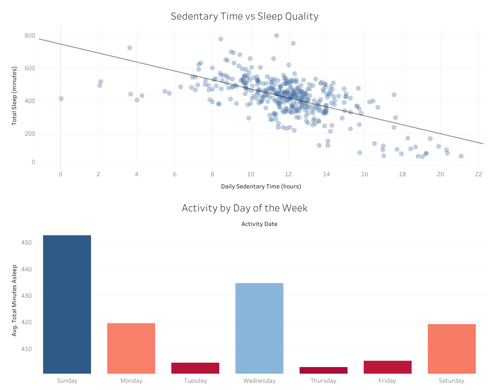

# Bellabeat Case Study: Smart Device Usage Analysis

Capstone project for the **Google Data Analytics Professional Certificate**.
Tools: **Google Sheets**, **BigQuery (SQL)** and **Tableau**.

## Business task

Analyze data from Fitbit users to identify trends in smart device usage. The insights will guide Bellabeat's marketing strategy for its line of smart wellness products.

1. What are the trends in device usage?
2. How do these trends apply to Bellabeat customers?
3. How can these trends improve Bellabeat's marketing strategy?

## Data

[FitBit Fitness Tracker Data](https://www.kaggle.com/datasets/arashnic/fitbit), available on Kaggle. It contains activity, heart rate, sleep and step data from about 30 users.

Limitations:
- **Small sample:** only about 30 users, so reliability is low.
- **Third-party data:** collected through Amazon Mechanical Turk.
- **Not current:** collected in 2016, so it doesn't reflect post-pandemic habits.
- On the positive side, it is well documented.

The data is not included in this repository. Download it from the link above.

## Process

1. **Cleaning (Google Sheets):** removed 3 duplicate rows and standardized dates to `YYYY-MM-DD` to avoid issues in SQL.
2. **Joining (BigQuery):** joined *Daily Activity* with *Sleep Day* using an `INNER JOIN` on user `Id` and date.
   See [`sql/01_join_activity_sleep.sql`](sql/01_join_activity_sleep.sql).
3. **Grouping (BigQuery):** averaged sleep by sedentary level (under 8h, 8 to 12h, over 12h).
   See [`sql/02_sleep_by_sedentary_level.sql`](sql/02_sleep_by_sedentary_level.sql).
4. **Visualization (Tableau):** built a dashboard to explore the relationship between activity and sleep.

## Findings

1. **More sedentary time, less sleep.** There is a negative relationship between daily sedentary time and total sleep: the more time users spend inactive during the day, the less they sleep.
2. **Less sleep mid-week.** Tuesday and Thursday have the lowest average sleep, while Sunday and Wednesday have the highest.

## Recommendations for Bellabeat

1. **Sedentary alerts:** an app feature that tracks inactive time. If the user passes 10 hours of inactivity, the app suggests 10 to 15 minutes of movement before bed to improve sleep.
2. **Mid-week motivation:** a "Mid-week Refresh" campaign starting on Tuesdays, with push notifications offering relaxation tips such as meditation or breathing exercises.
3. **Personalized goals:** help users see how their daytime activity affects their sleep, encouraging changes to their daily routines.

## Repository contents

| Folder | Content |
|---|---|
| `sql/` | BigQuery queries used in the analysis |
| `images/` | Tableau dashboard |
| `notebook/` | Original notebook published on [Kaggle](https://www.kaggle.com/code/nicolagosduran/data-analysis-project-1) |

## Author

**Nicolás Lagos Durán** · [LinkedIn](https://www.linkedin.com/in/nicolas-lagos-abb675379) · [Kaggle](https://www.kaggle.com/nicolagosduran)
